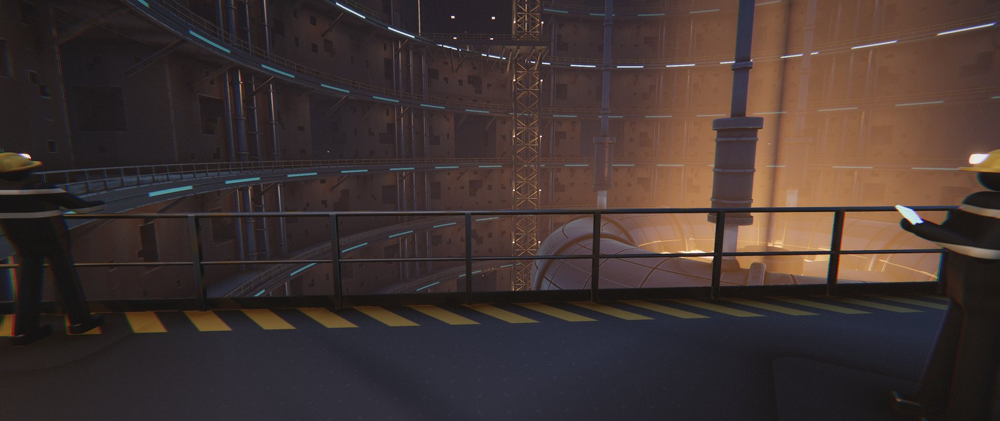
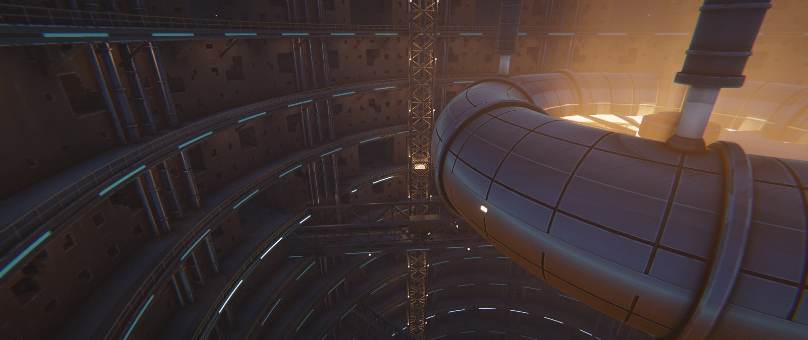
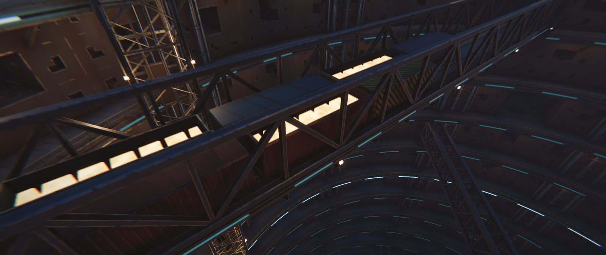
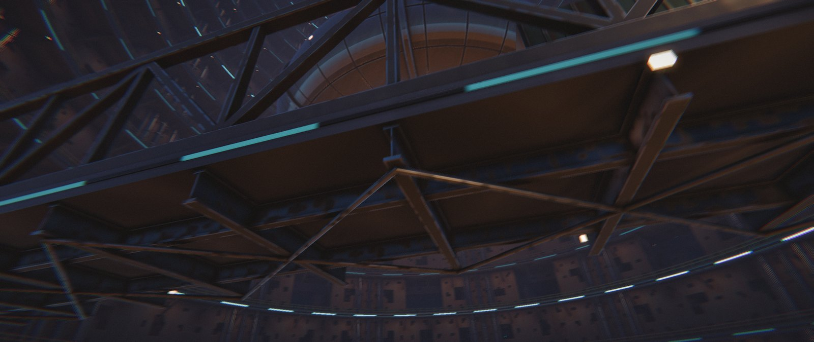
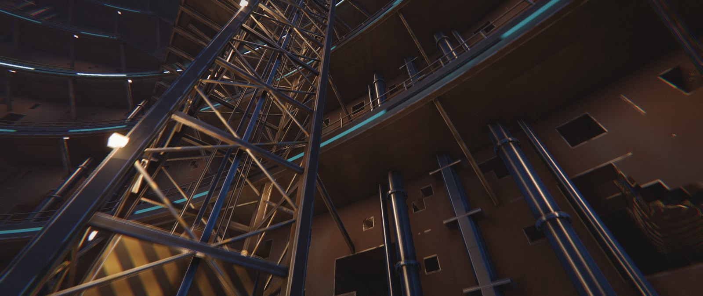
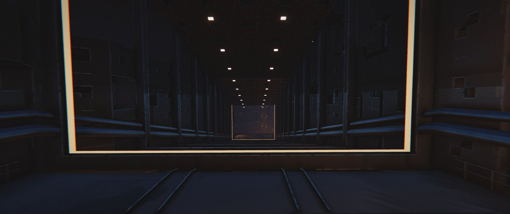

# ABYSS · 无限工业深渊

一座无限延伸的暗黑工业分形巨构深渊，风格参考《BLAME!》与《银翼杀手 2049》。

**所有可见结构都在片元着色器里用光线步进（Raymarching）与有符号距离场（SDF）实时生成**，场景中没有任何网格拼装，
每个渲染 pass 只画一个全屏四边形。项目运行在 TapTap Maker 的 UrhoX 引擎上，着色器使用引擎的 SurfaceShader（Godot 风格着色语言）。



| | |
|---|---|
|  |  |
|  |  |

## 画面里有什么

- **巨构与纵深**：竖井在水平 240 m、竖直 300 m 上周期重复，向任意方向无限延伸。井壁在圆柱展开坐标里用
  Menger 海绵（KIFS 盒子折叠）变体雕出多级孔洞，第 2、3 级孔洞按单元随机保留，打破规则网格。
- **尺度参照**：检修平台上的工人与齐腰高护栏；中景悬吊外径约 54 m 的环形锻炉；对面横跨井壁的货运桥；
  每 12 m 一层的环廊与横跨井腔的桁架层层没入雾中。
- **工业细节**：分块装甲板与板缝、倒角、焊缝、管道法兰与螺栓、阀门手轮；细节按像素覆盖做 LOD。
- **机构运动**（各自的速度）：炉口叶片旋转；锻炉起伏并轻微倾斜，四根液压活塞杆随之伸缩；
  两列货车反向穿过井壁隧道；升降舱沿钢索往返停靠，配重反向运动。
- **材质**：粗糙铸铁、各向异性拉丝钢板、带车削纹的抛光活塞杆、涂装结构钢；油渍与积水、曲率驱动的边缘磨损、锈迹滴流。
- **光影**：锻炉熔芯光与 SDF 软阴影；环廊青色能量槽、檐下灯、工作灯的解析光照；沿法线多次采样的 AO 结合步进次数；
  深蓝 / 暗橙指数距离雾；沿视线累积的体积光（炉口上方随叶片旋转的光柱）。
- **后期**：ACES Filmic、胶片暗角、径向色散、受控辉光、胶片颗粒与抖动去色带。
- **抗锯齿**：Halton 子像素抖动 + 深度重投影 TAA（YCoCg 方差裁剪、Catmull-Rom 历史采样）；
  栏杆、钢索、斜撑等细杆半径不小于像素覆盖并按覆盖率淡出；按法线变化放宽粗糙度，抑制高亮炉缘的高光闪烁；
  程序化纹理按像素覆盖钳制频率。

## 30 秒巡航镜头

一次连续穿行：从检修平台缓慢探出、护栏掠过画面 → 贴着锻炉侧面前进 → 低头俯冲穿过货运桥下 → 回望头顶桁架 →
仰头沿升降塔爬升 → 越过上层平台，望向下一座井腔。前进过程中偏航单调完成 360°，伴随明显的俯仰与高度变化。
第 30–44 秒穿过连廊进入下一座井，无缝接回开场，巡航可以无限循环。



## 操作

| 输入 | 作用 |
|---|---|
| 移动鼠标（巡航中） | 小幅微调视角，停止移动 3 s 后回正 |
| 按住拖动 | 接管镜头，松手保留朝向 |
| W / S · A / D · Q / E · Shift | 前进后退 · 横移 · 升降 · 加速 |
| R / P | 恢复巡航（从最近的路径点平滑过渡）/ 重播开场 |
| 手机 | 右侧拖动转向，左下拖动飞行 |

左上角等宽 HUD 显示深度与辐射读数，并提供暂停与配色（AMBER / HAZE / MONO）按钮。

## 运行

在 TapTap Maker 中新建项目，把本仓库的 `scripts/` 与 `assets/` 放到项目根目录，入口为 `scripts/main.lua`。

- 使用前向渲染管线（项目默认）。
- 着色器较重，内置 7 档动态分辨率（1.0–0.35）：桌面从 0.72 起步、手机从 0.5 起步，按帧时间自动升降，目标 60 FPS。
  步进次数、体积光采样数等开销参数在 `scripts/main.lua` 与 `scripts/Abyss/Pipeline.lua` 里。
- 开发中只在桌面 OpenGL 上验证过画面，其他图形后端未逐一验证。

## 目录

```
scripts/
  main.lua                  入口：交互模式与录制模式
  record.lua                录制入口：固定帧率逐帧渲染 PNG
  dev_one.lua, dev_still.lua 开发用：渲染巡航路径上指定时刻的单帧
  Abyss/
    Pipeline.lua            五个全屏 pass 的渲染目标、uniform 与动态分辨率
    CameraPath.lua          巡航关键帧与非均匀 Catmull-Rom 插值
    Controls.lua            巡航、手动飞行与触屏控制
    Mechanics.lua           各机构的运动状态（只由时间决定，可逐帧重现）
    HUD.lua                 左上角 HUD
    Palettes.lua            三套配色
assets/Shaders/BLGL/Abyss/
  March.shader              光线步进、光照、雾与体积光
  Scene.shaderinc           场景 SDF
  Shade.shaderinc           材质、阴影与 AO
  Common.shaderinc          哈希、噪声、SDF 基本体
  Taa.shader, Bloom.shader, Final.shader  TAA、辉光、最终合成
tools/abyss/                逐帧录制、单帧与联系表工具
```

## 渲染管线

`march`（RGBA16F：HDR 颜色 + 射线距离）→ `TAA`（历史乒乓）→ `bloom 1/4` → `bloom 1/16` → `final`。

每个 pass 是一个小场景里的全屏四边形，渲染到纹理。各 pass 的执行顺序由渲染目标纹理首次创建的先后决定
（先创建的后渲染），所有渲染目标都手动排队更新，详见 `scripts/Abyss/Pipeline.lua` 开头的注释。

## 录制预览视频

见 [tools/abyss/README.md](tools/abyss/README.md)。录制时动画时间按帧号确定，与实际帧率无关；
每帧可累积多次子像素抖动采样，并把采样时刻分布在快门时间内形成运动模糊。

## 许可证

[MIT](LICENSE)
